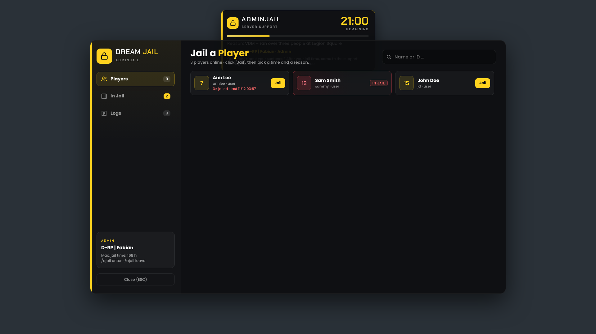
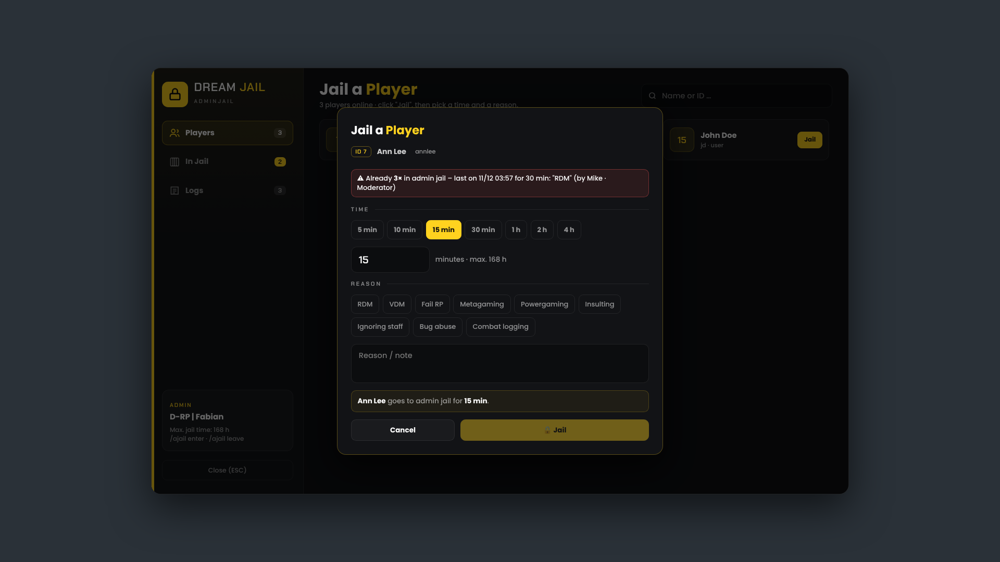

# Dream Adminjail

Admin jail with its own panel: jail online players with a time and reason, edit or end sentences, see each player's jail history, browse logs, optional Discord webhook.

> Built with AI assistance, tested on our live roleplay server DreamRP (ESX Legacy). Other frameworks are marked as beta where they apply. Version 1.3.2 (from `fxmanifest.lua`). Resource folder: `dream_adminjail`.

## Features

- Panel with tabs: Players (jail someone), In Jail (change remaining time or release), Logs (search, delete)
- Timed sentences with quick times, reasons and a maximum time per group
- Jail history per player and logs (deleted after 30 days by default)
- Rank rules: nobody can jail a higher rank or lift a jail set by a higher rank, nobody can change his own jail
- Jailed players see a display with countdown, reason and staff member
- Time counts down on the server, only while the player is online, the jail survives logout
- Character switch: the jail of the old character is saved and paused
- Staff can visit the jail (`/ajail enter`, `/ajail leave`)
- Server-side position check (needs OneSync) and optional own routing bucket for the jail
- Nearby players see a message when someone is jailed
- Optional Discord log through a server-side webhook
- Per-player rate limits on panel requests

## Requirements

- `oxmysql` (required, `dependency` in `fxmanifest.lua`)
- One of: `es_extended` (ESX Legacy), `qb-core` or `qbx_core` (beta), or no framework (standalone, beta)
- Optional: `ox_lib` for notifications

| `Config.Framework` | Jails are stored per | Staff rank comes from |
| --- | --- | --- |
| `'auto'` (default) | picks qbx_core, then qb-core, then es_extended, otherwise standalone | |
| `'esx'` | ESX identifier | ESX group |
| `'qbcore'` / `'qbox'` (beta) | citizenid | ACE: `god` = superadmin, `admin`, `mod` |
| `'standalone'` (beta) | FiveM license | ACE as above |

QBCore, Qbox and standalone are beta: tested in simulation, not yet on a live server. Switching the framework later does not carry running jails over.

## Installation

1. Stop any other admin jail resource first.
2. Put the folder `dream_adminjail` into your `resources` folder.
3. Add `ensure dream_adminjail` to your `server.cfg`, after `oxmysql` and after your framework.
4. Start the server. The database tables are created automatically and a jail location is preset.
5. Optional: enter a Discord webhook in `server_config.lua` (server only, empty = off).

## Configuration

`config.lua` (shared), `server_config.lua` (server only), `locales.lua` (texts).

| Option | Default | Meaning |
| --- | --- | --- |
| `Config.Framework` | `'auto'` | `'auto'`, `'esx'`, `'qbcore'`, `'qbox'`, `'standalone'` |
| `Config.UseOxLib` | `true` | Use ox_lib notifications when running |
| `Config.Locale` | `'en'` | `'en'` or `'de'` |
| `Config.Command` / `Config.VisitCommand` | `'adminjail'` / `'ajail'` | Command names |
| `Config.DefaultMinutes` | `15` | Preselected time |
| `Config.QuickTimes` | `5, 10, 15, 30, 60, 120, 240` | Quick picks in minutes |
| `Config.MaxMinutes` | `10080` | Overall maximum (7 days) |
| `Config.Reasons` | RDM, VDM, Fail RP, ... | Quick reasons |
| `Config.Jail` | radius `40.0`, godmode, no weapons | Jail position and rules |
| `Config.NearbyNotify` | enabled, `50.0` | Message to nearby players |
| `ServerConfig.Permissions` / `Ranks` | owner to support | What each group may do, rank order |
| `ServerConfig.MaxByGroup` | support 60, mod 240 | Maximum time per group (minutes) |
| `ServerConfig.LegacyJailRank` | `'admin'` | Rank of jails from versions before 1.3 |
| `ServerConfig.DeleteLogsAfter` | `720` | Hours until logs and jail history are deleted, `0` = keep |
| `ServerConfig.Bucket` | `0` | Routing bucket in jail. Recommended: an unused number, for example `77` |
| `ServerConfig.ServerCheck` | enabled, every 5 s, margin 25 | Server-side position check (needs OneSync) |
| `ServerConfig.Webhook` | empty | Discord webhook, server only |

## Commands and keys

- `/adminjail`: opens the panel (groups from `ServerConfig.Permissions` or ACE `command`). No key of its own.
- `/ajail enter` and `/ajail leave`: staff visit the jail

## Exports and events

- Server: `exports.dream_adminjail:JailPlayer(adminSrc, targetSrc, minutes, reason)`, `exports.dream_adminjail:UnjailPlayer(adminSrc, targetSrc)`, `exports.dream_adminjail:IsJailed(src)`. `adminSrc` is the server id of the staff member (same rules as the panel) or `0` for console / a trusted script.
- Client: `exports.dream_adminjail:OpenMenu()` or `TriggerEvent('dream_adminjail:open')`, `exports.dream_adminjail:IsJailed()`

## Localization

English (default) and German via `Config.Locale`. Panel, jail display, notifications and Discord log texts are in `locales.lua`. Messages to jailed players can be overridden one by one in `Config.Language`. The quick reasons in `Config.Reasons` are plain text, write them in your server's language.

## Performance

Resmon values are **estimated from the code, set low on purpose** (not measured on every server setup): idle roughly 0.00-0.01 ms. Values rise briefly while the interface is open or while the script handles a request. Please check `resmon` on your own server.

## FAQ and troubleshooting

**Staff are not recognised (QBCore, Qbox, standalone).** Give the group the ACE permission, for example `add_ace group.admin admin allow` in `server.cfg`.

**Can players escape the jail?** Radius, teleport back, god mode and weapons run on the client, as with most jail scripts. A modified client can get around that. Use the server position check (on by default, needs OneSync) and give the jail its own routing bucket (`ServerConfig.Bucket = 77`).

**Logs or history disappeared.** They are deleted after `ServerConfig.DeleteLogsAfter` hours (default 720 = 30 days). Set `0` to keep them.

**A mod cannot lift a jail.** A higher rank set or extended it. Whoever edits a jail takes it over with his rank. Jails from versions before 1.3 count as set by `ServerConfig.LegacyJailRank`.

**Jail time does not run down.** The time only counts while the player is online.

**Two jail resources fight each other.** Stop other admin jail resources before starting this one.

## Support

- Support Discord: https://discord.gg/XhHQkkXkFW
- Store: https://dreamscripts.tebex.store
- All documentation: [DreamScripts Docs](../README.md)

## Changelog (short)

- 1.3.2: Fix for a script error when a player left, invalid times are refused, server moves escaped players back itself with OneSync.
- 1.3.1: Rank security fixes, server-side position check, `headadmin` permissions.
- 1.3.0 and earlier: see the full changelog.

Full changelog: `CHANGELOG.md` inside the resource.
