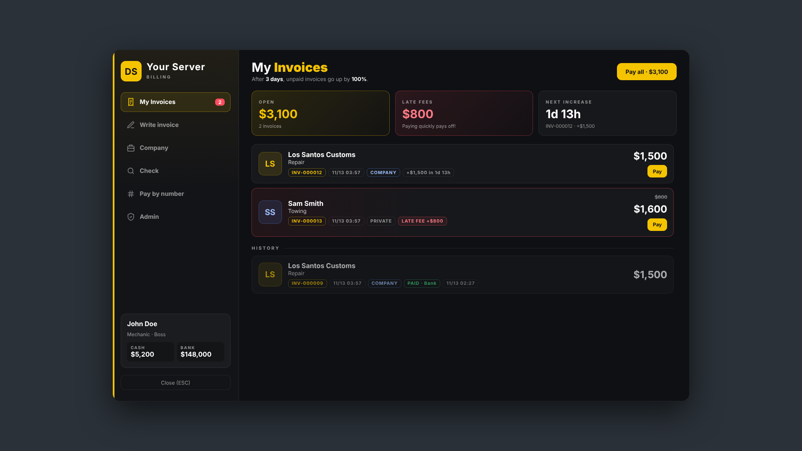
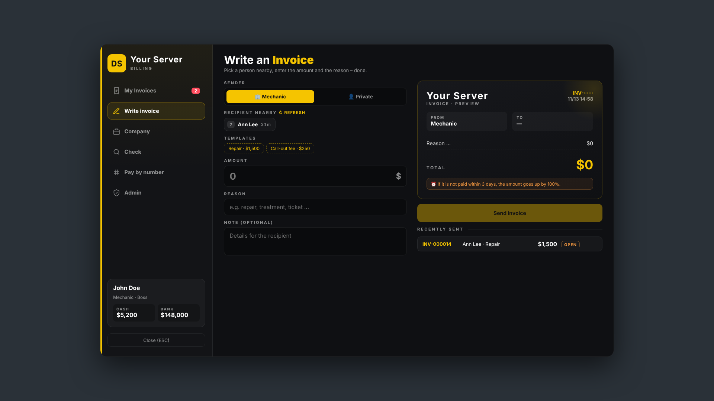

# Dream Billing

Billing system for ESX servers: job invoices, private invoices, automatic late fees, company overview for bosses, invoice lookup for the police and an admin area. Compatible with esx_billing.

> Built with AI assistance, tested on our live roleplay server DreamRP (ESX Legacy). Other frameworks are marked as beta where they apply. Version 1.1.6 (from `fxmanifest.lua`). Resource folder: `dream_billing`.

## Features

- Menu with the tabs "My invoices", "Write invoice", "Company", "Check", "Pay by number" and "Admin"
- Job invoices go to the company account `society_<job>`, private invoices go to the player
- Automatic late fee in stages (default: +100 % after 3 real days), booked by the server
- Pay in cash or by bank, pay all open invoices at once, pay someone else's invoice by its number (strangers never see the reason)
- Boss overview: open amount, income of the last 7 days, top employees, cancel open invoices
- Lookup of other persons' invoices for configured jobs (for example police) by server ID or name
- Admin area: search all invoices, delete, refund paid invoices, remove all open invoices of one sender
- Invoice templates per job, optional tax, optional Discord log through a server-side webhook
- Compatible with scripts that send `esx_billing:sendBill`, `esx_billing:getBills`, `esx_billing:payBill`
- Per-player rate limits on menu requests, paying and cancelling

## Requirements

- `es_extended` (ESX Legacy)
- `oxmysql`
- Optional: `esx_addonaccount` for company accounts `society_<job>`. Without it, money is booked directly in the table `addon_account_data`.

`es_extended` and `oxmysql` are listed under `dependencies` in `fxmanifest.lua`. QBCore, Qbox and standalone are not supported.

## Installation

1. Stop `esx_billing` if it is running, otherwise invoices arrive twice.
2. Put the folder `dream_billing` into your `resources` folder. Do not rename it.
3. Add `ensure dream_billing` to your `server.cfg`, after `es_extended` and `oxmysql` (and after `esx_addonaccount` if you use it).
4. Edit `config.lua` (jobs, late fee, theme). For a Discord log, enter your webhook in `server_config.lua`.
5. Start the server. The table `dream_billing` is created automatically, no SQL import needed.

## Configuration

Main file: `config.lua`. Texts: `locales.lua`. Server-only: `server_config.lua` (`Webhook`, `BotName`, `BotLogo`, `ImportOldTable`).

| Option | Default | Meaning |
| --- | --- | --- |
| `Config.Locale` | `'en'` | `'en'` or `'de'` |
| `Config.Command` / `Config.DefaultKey` | `'openbillingmenu'` / `'Y'` | Menu command and default key (players can rebind) |
| `Config.AdminCommand` | `'billingadmin'` | Opens the admin tab |
| `Config.Currency` | `'$'` | Currency sign |
| `Config.FullJobs` | `police`, `ambulance`, `mechanic` | Jobs where every employee may write invoices |
| `Config.BossOnlyOthers` | `true` | Other jobs with a company account: only the boss |
| `Config.ExcludeJobs` | `unemployed` | Jobs that may never write invoices |
| `Config.PersonalBills` | `true` | Allow private invoices |
| `Config.SearchJobs` | `police` | Jobs that may look up other persons' invoices |
| `Config.ForeignPayment` | `true` | Pay other people's invoices by number |
| `Config.AdminGroups` | `admin`, `superadmin` | Admin access (ACE `command` also counts) |
| `Config.MaxDistance` | `8.0` | Max. distance between sender and receiver |
| `Config.MaxAmount` / `Config.Tax` | `10000000` / `0` | Highest invoice amount / tax in % |
| `Config.LateFee` | enabled, `{ days = 3, percent = 100 }`, `checkMinutes = 10` | Late fee stages |
| `Config.Templates` | mechanic, ambulance | Quick buttons per job |
| `Config.SocietyPrefix` | `'society_'` | Prefix of company accounts |
| `Config.Notify` | `'esx'` | `'esx'` or `'custom'` |
| `Config.Theme` | gold accent | Colours, logo letters, server name |

## Commands and keys

- `/openbillingmenu` or key **Y** (default): open the menu
- `/billingadmin [search]`: open the admin tab (admins only), for example `/billingadmin INV-000123`

## Exports and events

- Server: `exports.dream_billing:CreateBill(senderSrc, targetSrc, amount, reason, useJob)` returns `true, id` or `false, message`
- Client: `exports.dream_billing:OpenBilling()` or `TriggerEvent('dream_billing:open')`
- `esx_billing:sendBill` (server event), `esx_billing:getBills` and `esx_billing:payBill` (server callbacks) are registered when `esx_billing` is not running

## Localization

English (default) and German via `Config.Locale`. Menu, notifications and Discord log texts are in `locales.lua`. Custom locale files from older versions: copy the new keys from the English block (see changelog).

## Performance

Resmon values are **estimated from the code, set low on purpose** (not measured on every server setup): idle roughly 0.00-0.01 ms. Values rise briefly while the interface is open or while the script handles a request. Please check `resmon` on your own server.

## FAQ and troubleshooting

**Invoices arrive twice.** `esx_billing` is still running. Stop it. If it starts while Dream Billing runs, Dream Billing leaves the `esx_billing:sendBill` event to it and prints a warning.

**Invoices imported from `codem_billing` cannot be paid.** Old invoices without company and issuer are refused before any money moves. Delete or cancel them in the admin area.

**A refund pushes the company account below 0.** That is intended, the money may already have been spent.

**The menu shows an error instead of loading.** If the server does not answer within 10 seconds, the menu shows an error. Check the server console. Menu requests are rate limited per player.

**An employee cannot write invoices.** Check `Config.FullJobs`, `Config.BossOnlyOthers` and `Config.ExcludeJobs`.

**Custom language texts are missing.** Copy new keys from the English block of `locales.lua`; missing keys show the English default.

## Support

- Support Discord: https://discord.gg/XhHQkkXkFW
- Store: https://dreamscripts.tebex.store
- All documentation: [DreamScripts Docs](../README.md)

## Changelog (short)

- 1.1.6: Paying, paying all, cancelling and the `esx_billing` callbacks are rate limited per player. Invoices without company and issuer are refused before money moves.
- 1.1.5: New locale keys (singular texts), number text fixes.
- 1.1.0: Sale release.

Full changelog: `CHANGELOG.md` inside the resource.
