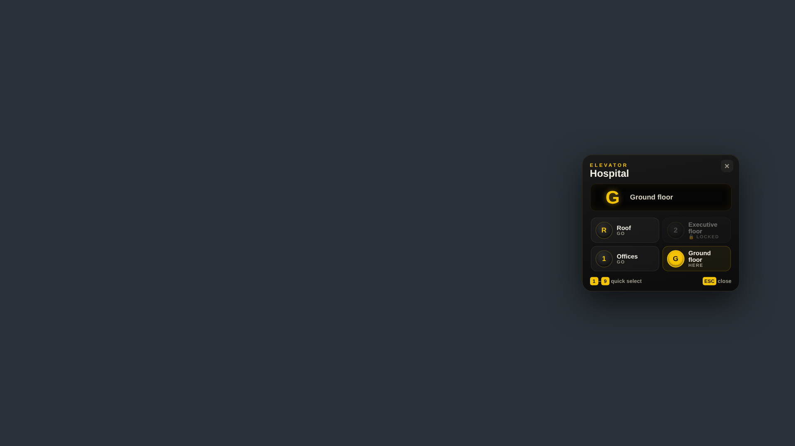
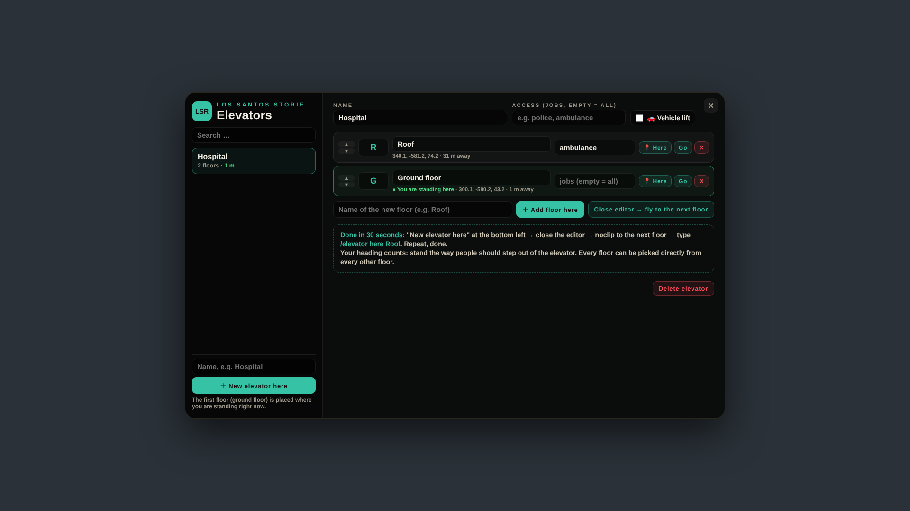

# Dream Elevator

Elevators and teleporters for ESX servers. Players pick any floor directly on a panel that looks like a real elevator. Elevators are built in game with an editor, no coordinates in config files.

> Built with AI assistance, tested on our live roleplay server DreamRP (ESX Legacy). Other frameworks are marked as beta where they apply. Version 1.1.2 (from `fxmanifest.lua`). Resource folder: `dream_fahrstuhl`.

## Features

- Elevator panel with all floors, highest floor on top, direct selection by keyboard (floor code, 1-9)
- Ride with fade-out, floor counter and an arrival sound generated in the interface (no sound files)
- Ride along: players standing next to you get "[E] Ride along" for a few seconds
- Vehicle lifts (for example an underground car park): the driver rides with the car and its passengers
- Job access for a whole elevator or for single floors, restricted elevators are invisible for everyone else
- In-game editor for admins: create, rename, floor codes, order, reposition, test ride, delete
- The server checks distance, access and cooldown of every ride
- Elevators are stored in the database, the table is created automatically
- Colours in `Config.Theme`

## Requirements

- `es_extended` (ESX Legacy)
- `oxmysql`
- `esx_textui` (ships with ESX Legacy, used for the "[E]" prompt through `ESX.TextUI`)

`es_extended` and `oxmysql` are listed under `dependencies` in `fxmanifest.lua`. The resource folder is named `dream_fahrstuhl` (kept for compatibility with existing installations), the product name is Dream Elevator.

## Installation

1. Put the folder `dream_fahrstuhl` into your `resources` folder. Do not rename it.
2. Add `ensure dream_fahrstuhl` to your `server.cfg`, after `es_extended`, `esx_textui` and `oxmysql`.
3. Edit `config.lua` (admin groups, distances, theme).
4. Start the server. The table `dream_fahrstuhl` is created automatically, no SQL import needed.

Building an elevator (admins):

1. Stand where the ground floor should be, facing the direction players should look after arriving.
2. `/elevator new Hospital` creates the elevator with its first floor (G) at your position.
3. Go to the next floor and type `/elevator here Roof`. Repeat for every floor.
4. `/elevator` opens the editor: rename, floor codes, order, job access, vehicle lift, test ride, delete.

## Configuration

Main file: `config.lua`. Texts: `locales.lua`.

| Option | Default | Meaning |
| --- | --- | --- |
| `Config.Locale` | `'en'` | `'en'` or `'de'` |
| `Config.Command` | `'elevator'` | Admin command for the editor |
| `Config.LegacyCommand` | `false` | `true` re-enables the old German command `/fahrstuhl` |
| `Config.AdminGroups` | `admin`, `superadmin` | ESX groups that may build elevators |
| `Config.AdminAce` | `'dream_fahrstuhl.admin'` | ACE permission for the editor |
| `Config.UseDistance` | `1.6` | Distance for [E] |
| `Config.VehicleDistance` | `5.0` | Distance for vehicle lifts |
| `Config.DrawDistance` | `18.0` | Marker visibility |
| `Config.TravelBase` / `TravelPerFloor` / `TravelMax` | `1400` / `350` / `3800` ms | Ride duration |
| `Config.Cooldown` | `3` | Seconds between two rides |
| `Config.Sound` / `Config.Volume` | `true` / `0.35` | Arrival sound |
| `Config.RideAlong` | `Enabled true`, `Radius 2.5`, `Seconds 7` | Ride along |
| `Config.Notify` | `'esx'` | `'esx'` or `'custom'` |
| `Config.Theme` | gold accent | Colours, logo letters, server name |

## Commands and keys

- Key **E** at a floor marker: open the panel
- `/elevator`: open the editor (admins)
- `/elevator new <name>`: new elevator, first floor at your position
- `/elevator here <name>`: add a floor at your position to the elevator you edited last (or the nearest one)

## Exports and events

None for other resources.

## Localization

English (default) and German via `Config.Locale`. All panel, editor and notification texts are in `locales.lua`. New elevators get English default floor names in English mode (Ground floor / G, Floor 1, ...). Existing elevators in the database are not changed.

## Performance

Resmon values are **estimated from the code, set low on purpose** (not measured on every server setup): idle roughly 0.00-0.01 ms. Values rise briefly while the interface is open or while the script handles a request. Please check `resmon` on your own server.

## FAQ and troubleshooting

**I cannot open the editor.** Your ESX group must be in `Config.AdminGroups`, or give the ACE permission: `add_ace group.admin dream_fahrstuhl.admin allow`.

**An elevator is invisible.** Elevators with job access are invisible for everyone without that job.

**`/fahrstuhl` does not work any more.** The old German command is off by default since 1.1.2. Set `Config.LegacyCommand = true`.

**Players cannot ride again immediately.** `Config.Cooldown` (default 3 seconds) applies, the server checks it.

**Vehicle lift does not take the car.** The driver must be within `Config.VehicleDistance` (default 5 m) of the floor point.

## Support

- Support Discord: https://discord.gg/XhHQkkXkFW
- Store: https://dreamscripts.tebex.store
- All documentation: [DreamScripts Docs](../README.md)

## Changelog (short)

- 1.1.2: ESX object is local, editor permission also by ACE (`Config.AdminAce`), old German command off by default.
- 1.1.1: English default language, `Config.Command`, English sub-commands.
- 1.1.0: Sale release.

Full changelog: `CHANGELOG.md` inside the resource.
