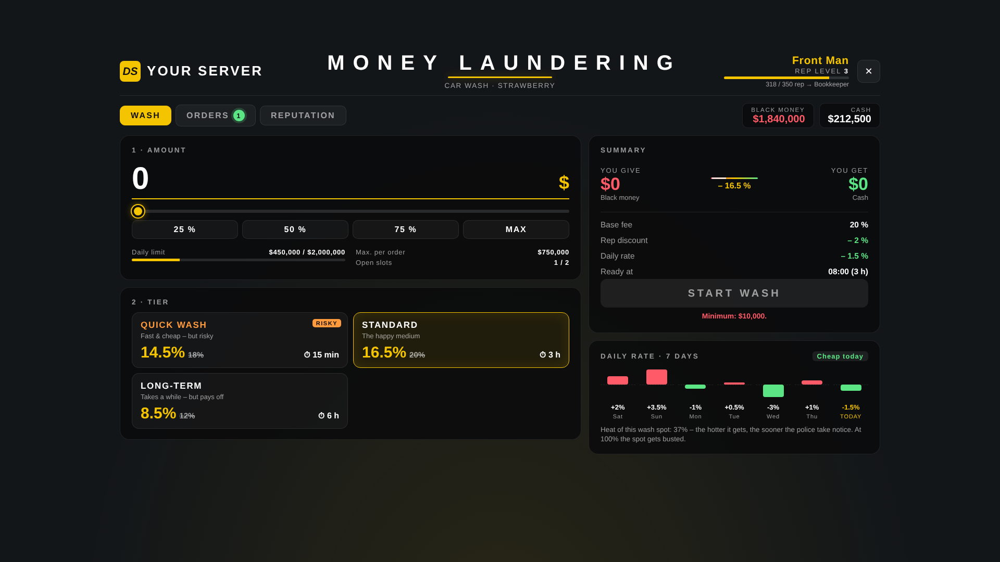

# Dream Moneywash

Money laundering for ESX servers. Players hand in black money at one of the currently open wash spots and collect clean money after a waiting time.

> Built with AI assistance, tested on our live roleplay server DreamRP (ESX Legacy). Other frameworks are marked as beta where they apply. Version 1.1.2 (from `fxmanifest.lua`). Resource folder: `dream_moneywash`.

## Features

- Pool of wash spots, only a configurable number is open at the same time (default 2), re-rolled on every start
- Heat per spot: every wash heats the spot up, at 100 % it is busted, closes and another one opens
- Informant ped who sells the current locations for black money (blips for a limited time)
- Wash tiers with different fee and waiting time, including a risk tier with seizure and police chance
- Reputation with 8 levels: fee discount, more parallel orders, higher limits, spots always on the map
- Daily rate that moves the fee up or down every day, shown as a 7-day chart
- Daily limit and maximum amount per order, depending on the level
- Police alert with a moving area blip for the configured police jobs
- Admin command `/mwadmin`, optional Discord log through a server-side webhook
- Colours, logo letters and server name in `Config.Theme`

## Requirements

- `es_extended` (ESX Legacy, with the account `black_money`)
- `oxmysql`

Both are listed under `dependencies` in `fxmanifest.lua`. QBCore, Qbox and standalone are not supported.

## Installation

1. Put the folder `dream_moneywash` into your `resources` folder. Do not rename it.
2. Add `ensure dream_moneywash` to your `server.cfg`, after `es_extended` and `oxmysql`.
3. Edit `config.lua` (spots, tiers, levels, police jobs, theme). For a Discord log, enter your webhook in `server/config_server.lua`.
4. Start the server. The tables `dream_moneywash_players` and `dream_moneywash_jobs` are created automatically, no SQL import needed.
5. Check the spot coordinates in game. `/mwadmin pos` copies your current position.

## Configuration

Main file: `config.lua`. Texts: `locales.lua`. Server-only: `server/config_server.lua`.

| Option | Default | Meaning |
| --- | --- | --- |
| `Config.Locale` | `'en'` | `'en'` or `'de'` |
| `Config.BlackAccount` / `Config.PayAccount` | `black_money` / `money` | Account that is washed / payout account |
| `Config.Key` | `38` (E) | Interaction key |
| `Config.MinAmount` / `Config.MinFee` | `10000` / `8` | Smallest amount per order / lowest fee in % |
| `Config.BlockedJobs` | `police`, `ambulance` | Jobs that may not wash |
| `Config.Spots` / `Config.Active` | 6 spots / `2` | Spot pool / number of open spots |
| `Config.Distance` | `3.0` | Interaction radius in meters |
| `Config.Heat` | `per 50000`, `riskMult 2`, `decay 3`, `police 20` | Heat per washed amount, risk multiplier, cooling per 10 min, police bonus |
| `Config.Informant` | price `5000`, `blipSeconds 300` | Position, ped model, price, blip time |
| `Config.Tiers` | Quick Wash 18 % / 15 min, Express 30 % / 60 min, Standard 20 % / 180 min, Long-Term 12 % / 360 min (level 3) | Keep one tier with the id `standard` |
| `Config.Market` | `-4` to `4` | Range of the daily rate |
| `Config.RepPer` / `Config.Levels` | `10000` / 8 levels | Reputation per amount and level table |
| `Config.Police` | `jobs {'police'}`, `chance 15`, `cooldown 10`, `minutes 2`, `radius 60.0` | Alert settings |
| `Config.Notify` | `'esx'` | `'esx'` or `'custom'` with `Config.CustomNotify` |
| `Config.Theme` | gold accent | `accent`, `background`, `text`, `logoText`, `serverName` |

`server/config_server.lua`: `Webhook`, `AdminGroups`, `ImportOldTable`.

## Commands and keys

- Key **E** at an open wash spot or at the informant
- `/mwadmin pos` copies your position
- `/mwadmin spots` lists open spots with heat
- `/mwadmin rotate` re-rolls the open spots
- `/mwadmin info|rep|limit|done [id] [value]` shows player info, sets reputation, resets the daily limit, finishes all open orders

`/mwadmin` works for the ESX groups in `ConfigServer.AdminGroups` and the server console.

## Exports and events

None for other resources.

## Localization

English (default) and German via `Config.Locale`. All texts are in `locales.lua`, a new language is added by copying one block. Labels of spots, tiers and levels follow the chosen language while you keep the default values. `Config.Text` is an optional override table (empty by default).

## Performance

Resmon values are **estimated from the code, set low on purpose** (not measured on every server setup): idle roughly 0.00-0.01 ms. Values rise briefly while the interface is open or while the script handles a request. Please check `resmon` on your own server.

## FAQ and troubleshooting

**Players do not see all spots.** Intended since 1.1.2: each player only gets the spots near him. Players with the reputation perk (levels 5-8) see all of them.

**No wash spot is open at my coordinates.** Open spots are re-rolled on every start. Use `/mwadmin spots` to see them and `/mwadmin rotate` to re-roll.

**The informant does not appear.** If the ped model cannot be loaded, loading stops after 10 seconds with a console message. Check `Config.Informant.model`.

**The server stops with a tier error or no default tier.** Keep one tier with the id `standard` in `Config.Tiers`.

**Police are never alerted.** Check `Config.Police.jobs`, the 15 % base chance and the 10 minute global cooldown.

**The reputation tab shows "Long-term wash unlocked" at level 3.** This hint is fixed. If you change `minLevel` of the tier `long`, it no longer matches.

## Support

- Support Discord: https://discord.gg/XhHQkkXkFW
- Store: https://dreamscripts.tebex.store
- All documentation: [DreamScripts Docs](../README.md)

## Changelog (short)

- 1.1.2: Realistic police defaults (15 % base chance, 10 min cooldown), wash spots sent only to nearby players, informant model loading stops after 10 seconds.
- 1.1.1: English default language, texts in `locales.lua`, `/mwadmin` sub-commands in English.
- 1.1.0: Sale release.

Full changelog: `CHANGELOG.md` inside the resource.
