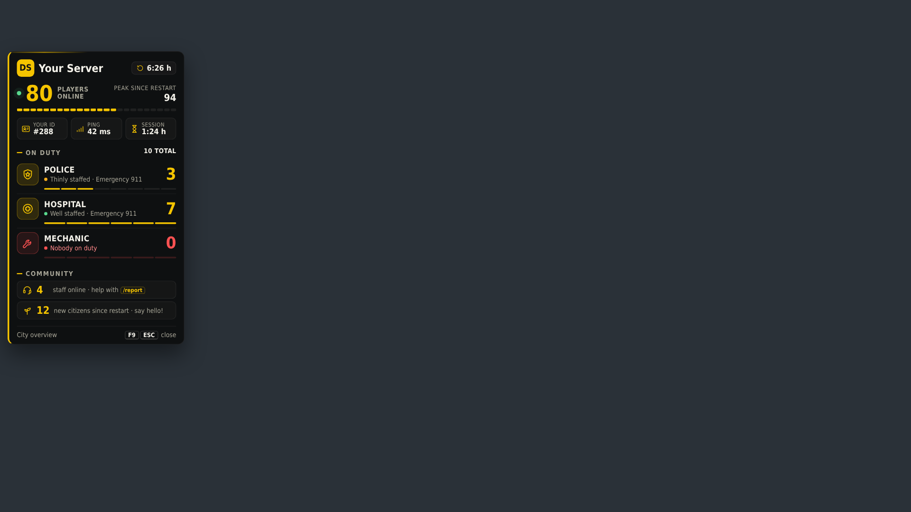

# Dream Scoreboard

A compact live city overview for roleplay servers. It slides in on the left without taking mouse focus, so players keep driving or walking. Numbers only, no player names.

> Built with AI assistance, tested on our live roleplay server DreamRP (ESX Legacy). Other frameworks are marked as beta where they apply. Version 2.3.1 (from `fxmanifest.lua`). Resource folder: `dream_scoreboard`.

## Features

- Players online with a capacity bar and the peak since the last restart
- Jobs on duty (for example police, hospital, mechanic) with count, status and a staffing bar, several job names can be counted together
- Your server ID, ping and session time
- Staff online with a support hint
- New citizens since the last restart (ESX only)
- Countdown to the next scheduled restart from the times in the config
- Opens with a key (default F9), closes with the same key or ESC, refreshes while open
- The server keeps only job and group per player and answers from a short cache
- No database needed
- Colours, logo letters and server name in `Config.Theme`

## Requirements

- Nothing required (no `dependencies` in `fxmanifest.lua`)
- Optional: `es_extended` (ESX Legacy), `qb-core` or `qbx_core` (beta)

| `Config.Framework` | Jobs | Staff | New citizens |
| --- | --- | --- | --- |
| `'auto'` (default) | picks qbx_core, then qb-core, then es_extended, otherwise standalone | | |
| `'esx'` | ESX jobs | ESX group | yes |
| `'qbcore'` / `'qbox'` (beta) | QBCore / Qbox jobs | ACE `god` = superadmin, `admin`, `mod` | hidden |
| `'standalone'` (beta) | none, job rows stay at 0 | ACE as above | hidden |

QBCore, Qbox and standalone are beta: tested in simulation, not yet on a live server.

## Installation

1. Put the folder `dream_scoreboard` into your `resources` folder. Do not rename it.
2. Add `ensure dream_scoreboard` to your `server.cfg`, after your framework (`es_extended`, `qb-core` or `qbx_core`) if you use one.
3. Edit `config.lua` (language, jobs, staff groups, restart hours, theme).

## Configuration

Main file: `config.lua`. Texts: `locales.lua`.

| Option | Default | Meaning |
| --- | --- | --- |
| `Config.Framework` | `'auto'` | `'auto'`, `'esx'`, `'qbcore'`, `'qbox'`, `'standalone'` |
| `Config.Locale` | `'en'` | `'en'` or `'de'` |
| `Config.Key` | `'F9'` | Default key (players can rebind) |
| `Config.RefreshMs` | `5000` | Refresh interval while open |
| `Config.OnlyOnDuty` | `false` | Count only players on duty |
| `Config.SoftCap` | `128` | Player number at which the top bar is full (visual only) |
| `Config.Restarts` | `{ 3, 15 }` | Restart hours in server time, `{}` hides the countdown |
| `Config.Jobs` | police, ambulance, mechanic | Rows: label, job names, icon, wanted number, hint |
| `Config.TeamGroups` | `mod`, `admin`, `superadmin` | Groups counted as staff |
| `Config.SupportHint` | `'/report'` | Text next to the staff count |
| `Config.Theme` | gold accent | Colours, logo letters, server name |

Icons: `police`, `hospital`, `mechanic`, `shield`, `taxi`, `gov`, `fire`, `car`.

## Commands and keys

- **F9** (default) or `/dreamscoreboard`: open / close
- **ESC**: close

## Exports and events

Optional: if another resource sets `GlobalState.dreamNextRestart` (unix time of the next restart), the countdown uses it instead of `Config.Restarts`.

## Localization

English (default) and German via `Config.Locale`. All texts are in `locales.lua`.

## Performance

Resmon values are **estimated from the code, set low on purpose** (not measured on every server setup): idle roughly 0.00-0.01 ms. Values rise briefly while the interface is open or while the script handles a request. Please check `resmon` on your own server.

## FAQ and troubleshooting

**Job rows show 0.** Jobs need ESX, QBCore or Qbox. Without a framework (standalone) they stay at 0. Check the job names in `Config.Jobs`.

**"New citizens" is missing.** It is shown on ESX only. QBCore, Qbox and standalone do not report new characters.

**Staff count is 0 on QBCore, Qbox or standalone.** Staff come from ACE permissions: `god` = superadmin, `admin`, `mod`. Example: `add_ace group.admin admin allow`.

**The restart countdown is missing.** `Config.Restarts` is empty, or the times do not match your server. Fill in the restart hours.

**The framework starts after the scoreboard.** Since 2.3.0 the scoreboard notices that and counts again right away.

**F9 is taken.** Change `Config.Key` or let players rebind it in the GTA key bindings.

## Support

- Support Discord: https://discord.gg/XhHQkkXkFW
- Store: https://dreamscripts.tebex.store
- All documentation: [DreamScripts Docs](../README.md)

## Changelog (short)

- 2.3.1: Documentation only. Standalone marked as beta.
- 2.3.0: Standalone mode (beta), faster player list refresh, number texts correct for every count.
- 2.2.0: Framework bridge with QBCore and Qbox support (beta).

Full changelog: `CHANGELOG.md` inside the resource.
