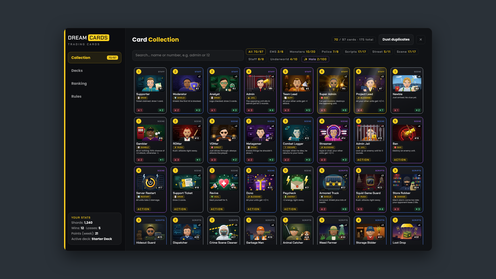
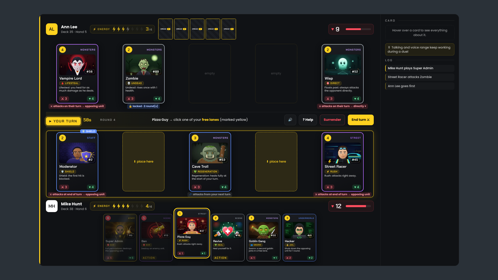
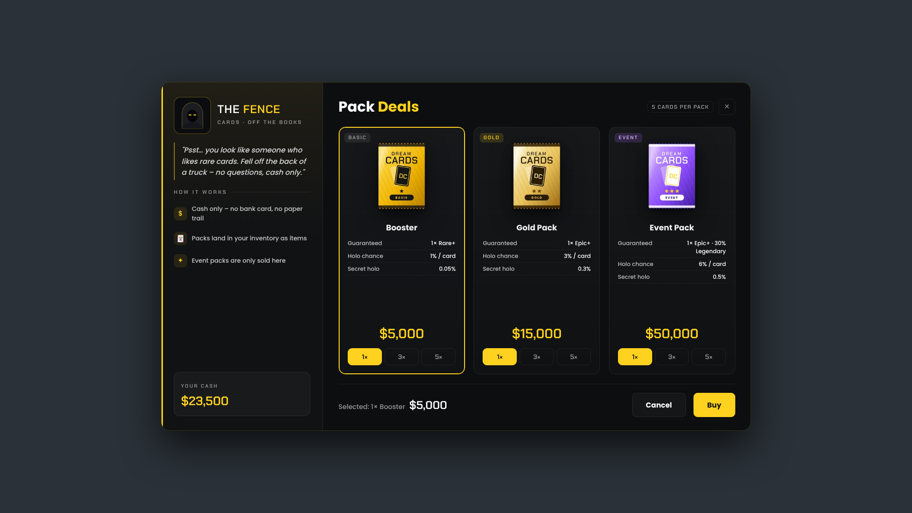
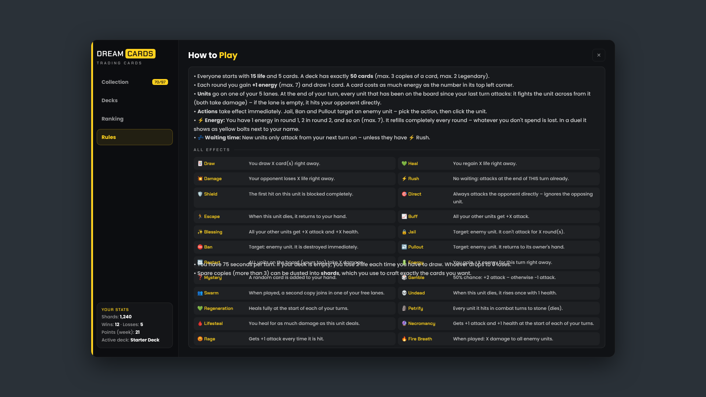

# Dream Cards

A trading card game for your server: collect cards from booster packs, build decks, duel other players or an NPC, trade, craft and climb a weekly ranking.

> Built with AI assistance, tested on our live roleplay server DreamRP (ESX Legacy). Other frameworks are marked as beta where they apply. Version 1.1.1 (from `fxmanifest.lua`). Resource folder: `dream_tcg`.

## Features

- 100 built-in cards in five rarities (Common, Rare, Epic, Legendary, Secret)
- Holo versions of every card (pack chance), plus 3 secret holo cards that only come from packs and cannot be crafted
- Collection album, deck builder with 3 deck slots (default deck of 50 cards, max. 3 copies, max. 2 Legendary/Secret)
- Duels against nearby players or an NPC, 5 lanes per player, 75 seconds per turn (all values in `Config.Rules`)
- Card trading between two players
- 3 booster items: Booster, Gold Pack, Event Pack. Only the packs are items, cards live in the database
- Card shop NPC (Booster and Gold Pack) and a "fence" dealer (all three packs, cash only)
- Shards: spare copies can be dusted into shards, shards are used to craft cards
- Weekly ranking (reset on Monday), top 3 receive packs at their next login
- Starter deck for new players on their first `/cards`
- Duel presentation: tablet animation and a "CARD DUEL" tag above players in a duel (switchable), voice chat keeps working
- Sounds are generated in the interface, no sound files needed

## Requirements

- `es_extended` (ESX Legacy)
- `oxmysql`

Both are listed under `dependencies` in `fxmanifest.lua`. QBCore, Qbox and standalone are not supported.

## Installation

1. Put the folder `dream_tcg` into your `resources` folder.
2. Import `items.sql` into your database (adds the 3 pack items), or add them to your inventory system. Copy the pictures from `items_bilder` into the image folder of your inventory (file name = item name).
3. Add `ensure dream_tcg` to your `server.cfg`, after `es_extended` and `oxmysql`.
4. Start the server. The card tables are created automatically.
5. Check the positions of the card shop and the dealer in game (`Config.Shop.coords`, `Config.Dealer.coords`) and adjust them.
6. Optional: enter a Discord webhook in `server_config.lua` (server only, empty = off).

## Configuration

Main file: `config.lua`. Texts: `locales.lua`. Server-only values: `server_config.lua`. These three stay editable when the resource is protected by Asset Escrow.

| Option | Default | Meaning |
| --- | --- | --- |
| `Config.Locale` | `'en'` | `'en'` or `'de'` |
| `Config.Command` | `'cards'` | Opens the collection |
| `Config.DuelCommand` | `'duel'` | `/duel ID`, `/duel yes`, `/duel no` |
| `Config.TradeCommand` | `'trade'` | `/trade ID`, `/trade yes`, `/trade no` |
| `Config.InviteRange` | `8.0` | Meters for a duel or trade invite |
| `Config.InviteTime` | `30` | Seconds to accept an invite |
| `Config.AdminGroups` | `superadmin`, `admin` | Groups that may use admin commands |
| `Config.Packs` | 3 packs | Price, holo chance, secret chance and rarity per card slot. Defaults: Booster 5000, Gold Pack 15000, Event Pack 50000 |
| `Config.Rules` | see right | `DeckSize 50`, `MaxCopies 3`, `MaxLegendary 2`, `DeckSlots 3`, `Lanes 5`, `Life 15`, `MaxLife 20`, `StartHand 5`, `MaxHand 9`, `MaxEnergy 7`, `TurnTime 75`, `Fatigue 2` |
| `Config.Ranking` | `WinPvP 3`, `WinNpc 1`, `NpcPointsPerDay 5` | Points per win and rewards for place 1-3 |
| `Config.Shop`, `Config.Dealer` | - | NPC model, position, blip, sold packs, account (`money`) |
| `Config.StarterCards` | - | Starter pack. It must add up to the deck size, the server prints a warning otherwise |
| `Config.Notify` | `nil` | Optional own notify function |

Add your own card: one line in `Config.Cards` with a unique id (picture optional in `html/img/cards/<id>.svg`).

## Commands and keys

| Command | Who | Action |
| --- | --- | --- |
| `/cards` | everyone | Collection, decks, ranking, rules |
| `/duel ID` | everyone | Challenge a nearby player. `/duel yes` or `/duel no` answers (`ja` / `nein` also work) |
| `/trade ID` | everyone | Trade cards. `/trade yes` or `/trade no` answers |
| Key **E** at the shop or dealer NPC | everyone | Buy packs, practice duel against the NPC |
| `/givecard ID cardid [amount]` | admins and console | Gives cards |
| `/giveitem ID tcg_booster` (or `tcg_booster_gold`, `tcg_booster_event`) | admins | Gives packs (normal ESX item command) |

Command names are configurable.

## Exports and events

No exports. The client events in `client/main.lua` (album, decks, duel and trade with the nearest player, accept or decline, ranking, rules) can be hooked into your own interaction menu, see `INSTALL.txt` inside the resource. Optional server hook: `Config.SeasonHook`.

## Localization

English (default) and German. Set `Config.Locale = 'de'` for German. Every player-visible text, including card names and card texts, is in `locales.lua`. Add a language by copying one block. German servers can set `Config.Command = 'karten'`, `Config.DuelCommand = 'duell'`, `Config.TradeCommand = 'tauschen'`.

## Performance

Resmon values are **estimated from the code, set low on purpose** (not measured on every server setup): idle roughly 0.00-0.01 ms. Values rise briefly while the interface is open or while the script handles a request. Please check `resmon` on your own server.

## FAQ and troubleshooting

**Packs do not exist as items.** Import `items.sql` or add `tcg_booster`, `tcg_booster_gold`, `tcg_booster_event` to your inventory.

**Pack pictures are missing in the inventory.** Copy the files from `items_bilder` into your inventory image folder. The file name must match the item name.

**Shop or dealer NPC stands in a wrong place.** Adjust `Config.Shop.coords` and `Config.Dealer.coords` (vec4). The ground height is found automatically.

**A duel or trade invite does not arrive.** The other player must be within `Config.InviteRange` (default 8 m) and must answer within `Config.InviteTime` (default 30 s).

**The server prints a starter pack warning.** The sum of `Config.StarterCards` must equal `Config.Rules.DeckSize`.

**A command clashes with another script.** Rename it in `config.lua` (`Config.Command`, `Config.DuelCommand`, `Config.TradeCommand`).

## Support

- Support Discord: https://discord.gg/XhHQkkXkFW
- Store: https://dreamscripts.tebex.store
- All documentation: [DreamScripts Docs](../README.md)

## Changelog (short)

- 1.1.1: English is the default language, German via `Config.Locale = 'de'`. All texts moved to `locales.lua`. Default commands are now `/cards`, `/duel`, `/trade`. Invites accept `yes` / `no`.
- 1.1.0: Sale release.

Full changelog: `CHANGELOG.md` inside the resource.
